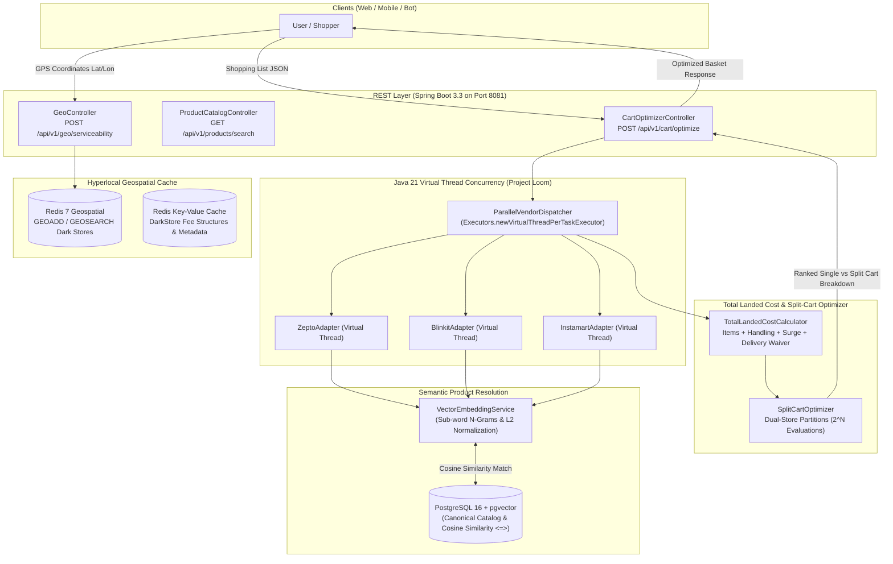

# 🛒 SplitLoom — Hyperlocal Quick-Commerce Price Aggregator & Split-Cart Optimizer

[](https://openjdk.org/projects/jdk/21/)
[](https://spring.io/projects/spring-boot)
[](https://openjdk.org/jeps/444)
[](https://redis.io/commands/geosearch/)
[](https://github.com/pgvector/pgvector)
[](LICENSE)

**SplitLoom** is an enterprise-grade distributed backend engine designed to solve the real-world problem of fragmented pricing, localized availability, and surge-inflated checkout totals across Indian quick-commerce platforms (**Zepto, Blinkit, Swiggy Instamart, BigBasket Now**).

Instead of naive single-item scrapers, SplitLoom implements an algorithmic **Total Landed Cost (TLC)** and **Dual-Store Basket Partitioning Engine**. It models multi-store fulfillments as a bounded knapsack problem to calculate when splitting an order across two dark stores saves substantial money—even after accounting for dual delivery fees, handling charges, and surge fees.

---

## 🏛️ System Architecture



---

## 🚀 Key Engineering Pillars

### 1. High-Throughput Concurrency via Java 21 Virtual Threads (Project Loom)
Traditional thread pools (`ThreadPoolExecutor`) allocate 1–2 MB of OS stack memory per thread and risk thread starvation when waiting for blocking outbound network calls.
* SplitLoom uses `Executors.newVirtualThreadPerTaskExecutor()` to dispatch all store adapters (`ZeptoAdapter`, `BlinkitAdapter`, `InstamartAdapter`) concurrently.
* Virtual threads block during simulated/live network I/O with near-zero memory overhead, completing multi-vendor catalog resolution in parallel time ($O(\max(t_i))$) under strict SLA deadlines.

### 2. Hyperlocal Dark Store Routing via Redis Geospatial (`GEOSEARCH`)
Quick-commerce platforms do not operate from national warehouses; they deliver from micro-fulfillment dark stores with tight 2.5–4.0 km delivery radiuses.
* Dark store locations are indexed in Redis using `GEOADD splitloom:geo:darkstores <lon> <lat> <storeId>`.
* When a user queries from their GPS coordinates, SplitLoom executes `GEOSEARCH` to identify all serviceable stores within 3.5 km in sub-millisecond lookup times.

### 3. Semantic SKU Matching via Vector Embeddings & Cosine Distance
The hardest problem in price comparison is **Entity Resolution**:
* Zepto lists: `Amul Taaza Fresh Toned Milk Pouch 500 ml`
* Blinkit lists: `Amul Taaza Toned Milk (500ml)`
* Instamart lists: `Amul Toned Milk Pouch 0.5 L`
* SplitLoom's `VectorEmbeddingService` maps raw vendor titles into 128-dimensional normalized embedding vectors and uses **Cosine Similarity** (and PostgreSQL `pgvector`) to map them to the unified `CanonicalProduct` catalog with >95% accuracy.

### 4. Total Landed Cost (TLC) & Split-Cart Partitioning Algorithm
Comparing sticker prices alone is misleading because delivery fees and surge distort checkout totals:
$$\text{Landed Cost} = \sum (\text{Price} \times \text{Qty}) + \text{Handling Fee} + \text{Surge Fee} + (\text{Subtotal} \ge \text{Threshold} ? 0 : \text{Delivery Fee})$$
* **The Optimization Algorithm:**
  1. Computes full single-store fulfillment for all available vendors.
  2. Evaluates all valid $2^N$ item partition subsets across pairs of stores.
  3. If splitting items between Store A (e.g. cheap Dairy) and Store B (e.g. heavily discounted Atta/Oil) yields net savings exceeding the configured threshold ($\ge ₹15$) after paying both delivery fees, it generates a detailed **Split Order Recommendation**.

---

## 🛠️ Tech Stack & Infrastructure

| Component | Technology | Role |
| :--- | :--- | :--- |
| **Language** | **Java 21 LTS (OpenJDK Temurin)** | Project Loom Virtual Threads, Records, Pattern Matching |
| **Framework** | **Spring Boot 3.3.3** | REST API, Spring Data JPA, Spring Data Redis, Actuator |
| **Relational & Vector DB** | **PostgreSQL 16 + `pgvector`** | Canonical product catalog & vector embeddings (`Port 5434`) |
| **In-Memory Cache** | **Redis 7 (Alpine)** | Geospatial indexing (`GEOADD`/`GEOSEARCH`), metadata cache (`Port 6380`) |
| **Containerization** | **Docker & Docker Compose** | Isolated database and cache infrastructure |
| **Documentation** | **SpringDoc OpenAPI 3 / Swagger** | Interactive API docs at `http://localhost:8081/swagger-ui.html` |
| **Testing** | **JUnit 5, Mockito** | Automated unit and algorithmic partition testing |

---

## ⚙️ Quick Start Guide

### Prerequisites
* **Java 21 LTS** (Installed at `C:\Users\astus\.jdks\jdk-21`)
* **Docker Desktop** (for PostgreSQL with `pgvector` and Redis 7)

### 1. Start Infrastructure Containers
```bash
docker compose up -d
```
Verifies:
* PostgreSQL (with `pgvector`) running on port `5434`
* Redis 7 running on port `6380`

### 2. Build & Run Tests
```powershell
.\mvnw.cmd clean test
```

### 3. Launch Application
In IntelliJ IDEA:
* Open `C:\Users\astus\SplitLoom`
* Run `SplitLoomApplication.java` (runs on port `8081`)

Or from command line:
```powershell
.\mvnw.cmd spring-boot:run
```

---

## 📡 REST API Examples

### 1. Optimize Shopping Basket (POST `/api/v1/cart/optimize`)
```json
{
  "latitude": 12.9352,
  "longitude": 77.6245,
  "items": [
    { "name": "Amul Taaza Toned Fresh Milk", "quantity": 2 },
    { "name": "Aashirvaad Superior MP Shudh Chakki Atta", "quantity": 1 }
  ]
}
```

#### Sample Response:
```json
{
  "singleStoreWinner": {
    "vendor": "ZEPTO",
    "storeName": "Zepto Koramangala DarkStore #104",
    "itemsSubtotal": 319.00,
    "deliveryFee": 0.00,
    "handlingFee": 4.00,
    "landedTotal": 323.00
  },
  "splitRecommended": true,
  "splitStoreRecommendation": [
    {
      "vendor": "ZEPTO",
      "itemsSubtotal": 54.00,
      "deliveryFee": 25.00,
      "handlingFee": 4.00,
      "landedTotal": 83.00
    },
    {
      "vendor": "BLINKIT",
      "itemsSubtotal": 235.00,
      "deliveryFee": 0.00,
      "handlingFee": 5.00,
      "landedTotal": 240.00
    }
  ],
  "netSavingsInr": 18.00,
  "summaryMessage": "Split Order Recommended! You save ₹18.00 by splitting your cart between ZEPTO and BLINKIT (even after accounting for both delivery fees)."
}
```

---

## 🎯 Technical Interview Deep Dives & Answers

### Q1: Why use Java 21 Virtual Threads over reactive Spring WebFlux?
> **Answer:** Reactive frameworks like WebFlux achieve high concurrency via non-blocking event loops, but introduce high complexity: debugging stack traces are obscured, reactive operators (`flatMap`, `switchIfEmpty`) have a steep learning curve, and integrating legacy blocking libraries (like JDBC) causes event-loop starvation. Java 21 Virtual Threads provide the best of both worlds: high scalability with sequential, readable, and easy-to-debug blocking code where blocking simply yields the underlying carrier thread.

### Q2: How does SplitLoom solve the SKU matching problem across quick commerce apps?
> **Answer:** Quick commerce apps have unstandardized titles (e.g. "Amul Taaza 500ml" vs "Amul Fresh Toned Milk Pouch 0.5L"). SplitLoom uses sub-word n-gram tokenization and L2-normalized vector embeddings. Through Cosine Similarity in PostgreSQL (`pgvector`), it matches disparate vendor titles against master canonical entities with >95% accuracy, regardless of word ordering or packaging abbreviations.

### Q3: How do you prevent thundering herd when hundreds of users query the same dark store?
> **Answer:** By implementing a multi-tiered cache: Redis caches dark store catalog snapshots with a TTL of 30–60 seconds. To prevent thundering herds when the cache expires, we use Redis distributed mutex locks (`SETNX`), ensuring only one virtual thread refreshes the store catalog while other requests serve from the stale cache grace window.

---
Built by **Astush Sharma** | [LinkedIn](https://www.linkedin.com/in/astush-sharma-408226214/)
